# Coffee Shop Sales & Inventory Analysis

A Python data analysis project exploring one year of synthetic coffee shop sales, product and inventory data. The project uses Pandas and Matplotlib to assess sales performance, product demand, stock movement, replenishment and wastage.

**Dataset period:** 1 January – 31 December 2025

## Project objectives

- Audit datasets and check data quality.
- Validate relationships between sales, products and inventory.
- Analyse revenue, orders, product performance and sales patterns.
- Examine stock levels, replenishment and wastage.
- Compare product demand with inventory activity.
- Turn findings into practical recommendations.

## Datasets

| File | Records | Description |
|---|---:|---|
| `sales_transactions.csv` | 25,000 | Transaction-level sales data, including products, quantities, prices, discounts, payment methods and order channels. |
| `products.csv` | 40 | Product catalogue containing product details, categories and pricing/cost information. |
| `daily_inventory.csv` | 14,600 | Daily inventory records for 40 products across 365 days. |

### Dataset origin

The datasets are synthetically generated with AI assistance for educational and portfolio purposes. They do not represent real business transactions.

## Tools and technologies

- **Python** – analysis and data processing
- **Pandas** – data loading, cleaning, validation, aggregation and analysis
- **Matplotlib** – charts and visualisation
- **pathlib** – project file paths

## Analysis workflow

1. **Data loading and audit:** reviewed dataset dimensions, data types, missing values and duplicate records.
2. **Data validation:** checked identifiers, product references, dates, positive values, sales calculations, inventory balances and consistency between recorded sales and inventory units sold.
3. **Sales analysis:** calculated revenue and estimated gross profit, and explored monthly, daily and hourly performance, product/category performance, payment methods and order channels.
4. **Inventory analysis:** examined stock received, units sold, wastage, reorder events and low-stock days.
5. **Demand and inventory comparison:** compared product demand with stock received, average stock, wastage and indicative stock cover.
6. **Recommendations:** identified areas where replenishment and waste-management processes could be reviewed.

## Key findings

### Sales performance

| Metric | Result |
|---|---:|
| Net revenue | £123,890.70 |
| Transactions | 16,000 |
| Units sold | 34,349 |
| Estimated gross profit | £91,873.27 |
| Average order value | £7.74 |
| Estimated gross profit margin | 74.16% |

- August generated the highest monthly revenue at **£12,039.96**.
- Latte was the highest-revenue product, generating **£6,202.93** from 1,652 units sold.
- Coffee was the highest-revenue category at **£46,091.14**.
- The 09:00 hour generated the highest revenue at **£16,039.28**.
- Takeaway generated **£65,995.50** in revenue, the largest share by order channel.

### Inventory and demand

- Total units received: **34,043**.
- Total units sold: **34,349**.
- Total units wasted: **766**.
- Overall wastage rate: **2.11%**, calculated using opening stock counted once per product plus units received.
- Recorded reorder events: **957 product-days**.
- Product-days with zero closing stock: **0**.
- Product-days at or below the reorder level: **404**.
- Latte had the highest demand (1,652 units) and the lowest indicative stock cover among the products analysed (approximately 9.65 days).
- Chocolate Muffin had the highest wastage relative to sales, at approximately **8.49 units wasted per 100 sold**.

## Visualisations

The charts below are generated by the analysis script and saved in the `charts/` directory.

### Sales analysis

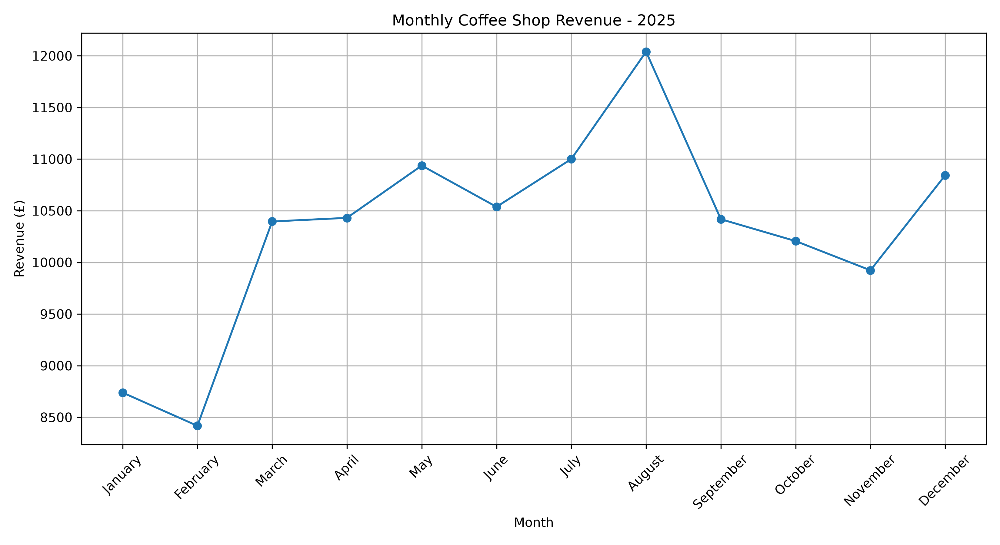

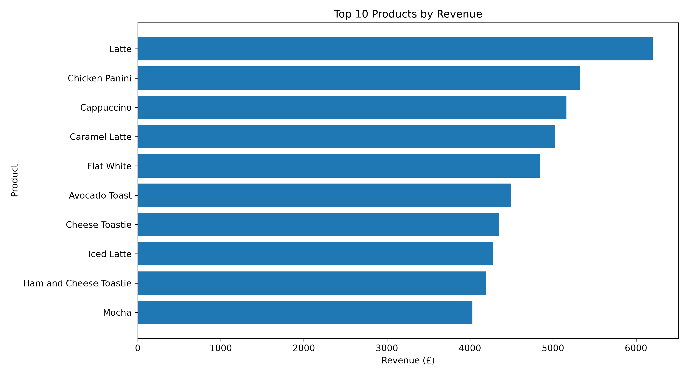

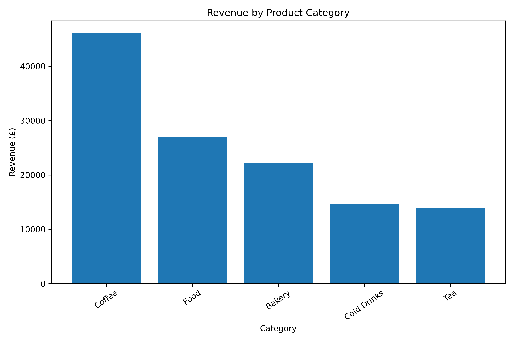

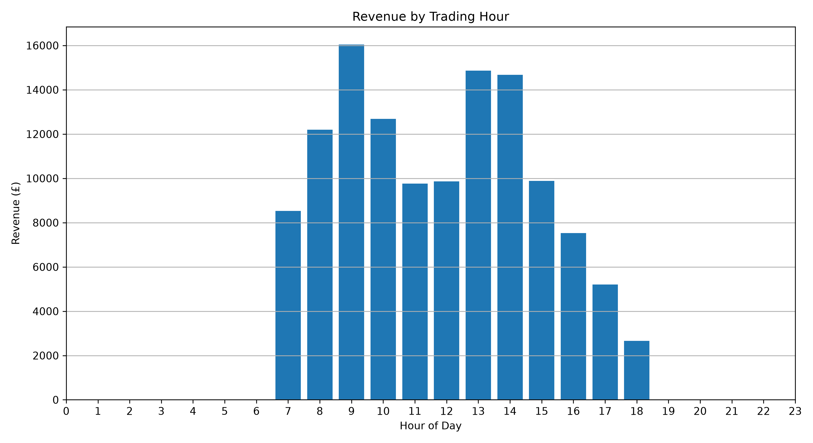

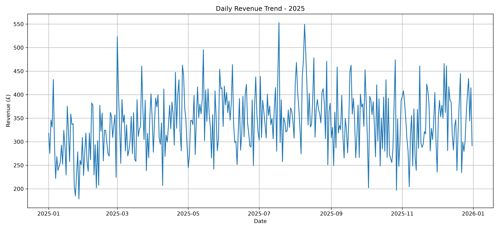

### Inventory analysis

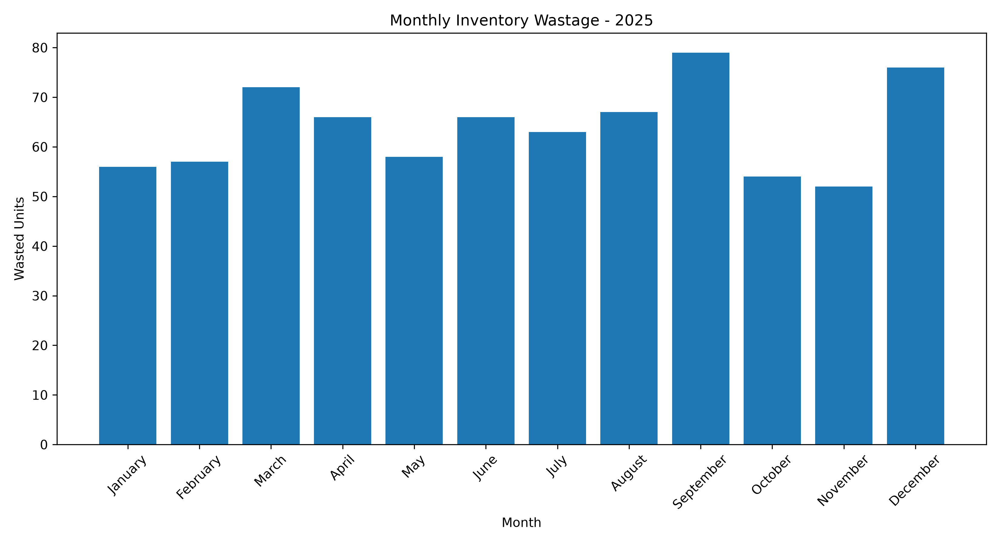

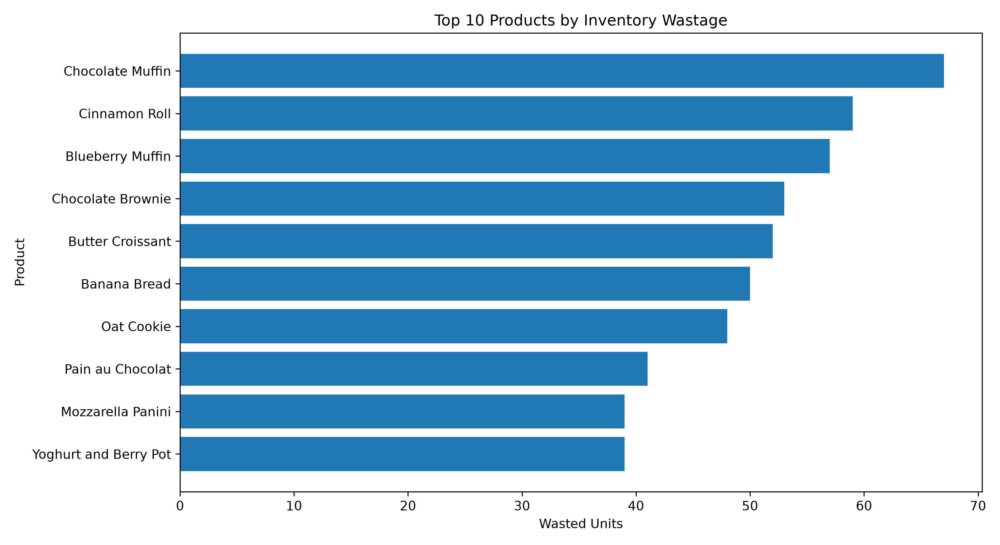

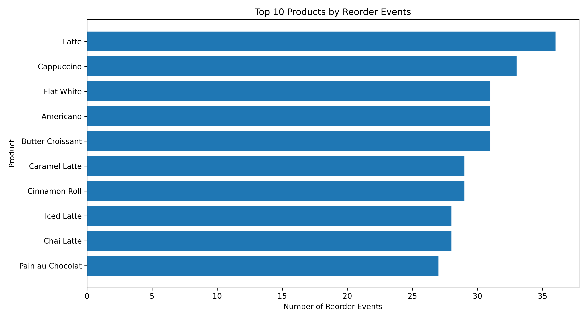

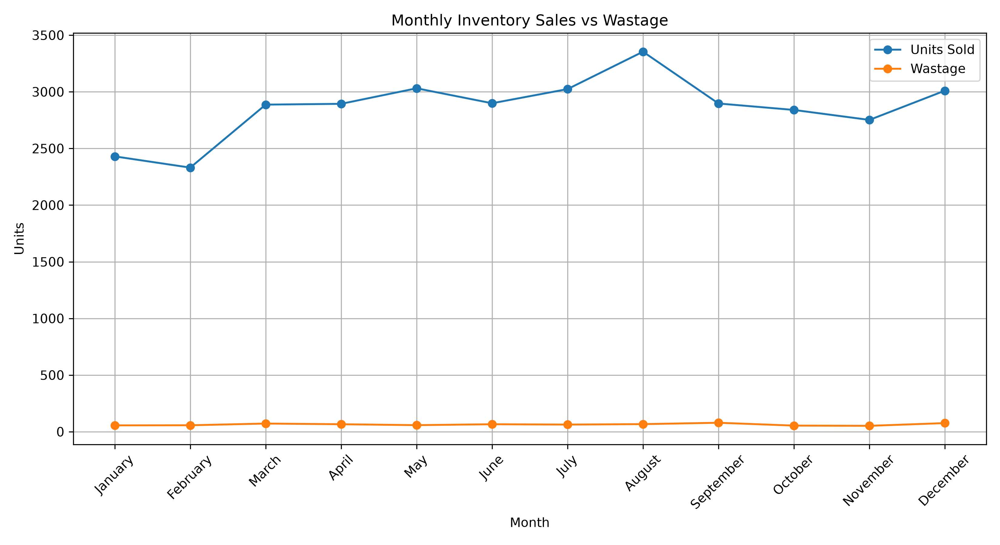

### Demand and stock analysis

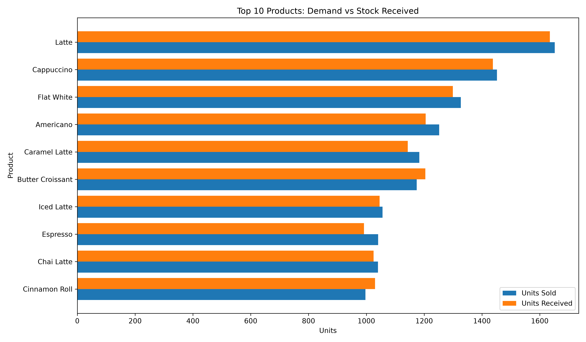

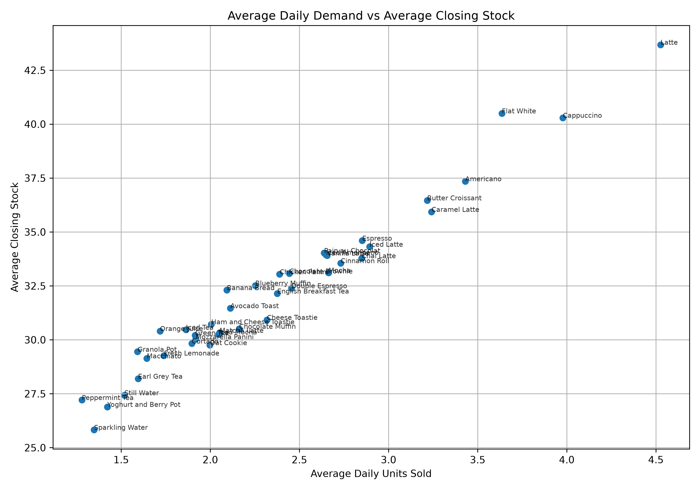

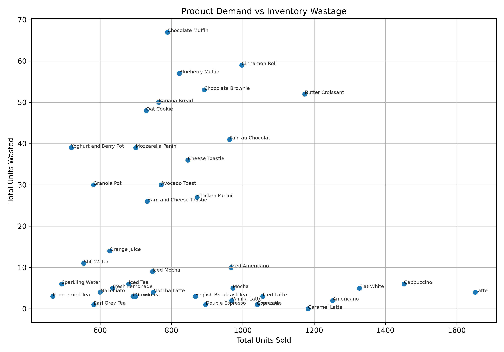

## Recommendations

1. **Review replenishment for high-demand products.** Monitor demand and stock cover for products such as Latte, Cappuccino and Flat White so reorder settings reflect sales activity.
2. **Investigate avoidable wastage.** Review preparation quantities and demand patterns for products with high wastage relative to units sold, particularly Chocolate Muffin.
3. **Review reorder thresholds.** Use product-level demand and low-stock frequency to assess whether current reorder levels and replenishment frequency are appropriate.

These are recommendations for further operational review; the synthetic data does not establish that stockouts or lost sales occurred.

## Data considerations and limitations

- The datasets are synthetic, so findings should not be interpreted as evidence about a real coffee shop.
- Estimated gross profit is calculated from the supplied sales and product cost fields; it does not include overheads or other operating expenses.
- Stock cover is an indicative measure based on average closing stock and average daily demand, not a live forecast.
- No lost-sales data is provided. Recorded zero closing stock or low stock cannot establish how much demand, if any, was lost.
- Annual units received compared with annual units sold must be interpreted alongside opening and closing stock.
- One year of synthetic data is insufficient to establish reliable recurring seasonality.
- Data validation checks confirm consistency against the rules tested; they do not prove that synthetic records reflect real-world conditions.

## Project structure

```text
coffee-shop-synthetic-dataset/
├── data/
│   ├── sales_transactions.csv
│   ├── products.csv
│   └── daily_inventory.csv
├── scripts/
│   └── coffee_shop_sales_inventory_analysis.py
├── charts/
├── requirements.txt
├── README.md
└── .gitignore
```

## Run the analysis

Clone the repository and move into the project directory:

```bash
git clone https://github.com/Hassan-Naveed1/coffee-shop-synthetic-dataset.git
cd coffee-shop-synthetic-dataset
```

Create and activate a virtual environment:

**Windows PowerShell**
```powershell
python -m venv .venv
.venv\Scripts\Activate.ps1
```

**macOS / Linux**
```bash
python3 -m venv .venv
source .venv/bin/activate
```

Install dependencies and run the script:

```bash
pip install -r requirements.txt
python scripts/coffee_shop_sales_inventory_analysis.py
```

## Author

**Hassan Naveed**  
[GitHub](https://github.com/Hassan-Naveed1)
